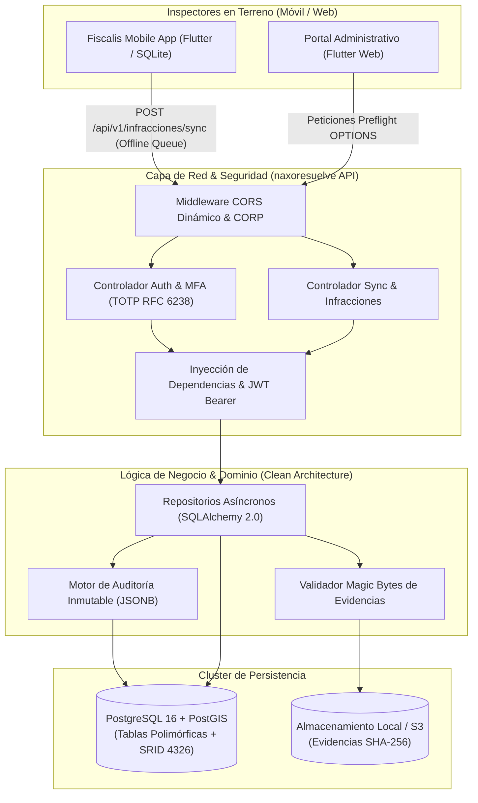

# naxoresuelve 🏛️
### SGF_CORE — Motor Transaccional y Backend de Fiscalización Municipal

[](https://www.python.org/)
[](https://fastapi.tiangolo.com/)
[](https://www.postgresql.org/)
[-D71F00.svg?logo=sqlalchemy&logoColor=white)](https://www.sqlalchemy.org/)
[-brightgreen.svg?logo=pytest&logoColor=white)](https://pytest.org/)
[](#-arquitectura-del-sistema)
[](#-licencia)

---

## 📖 Descripción General

**naxoresuelve** es el backend transaccional de alta resiliencia y motor geoespacial del **Sistema de Gestión Fiscalizadora Municipal (SGF)**.

Diseñado bajo el paradigma **Offline-First** y principios de **Clean Architecture**, resuelve de forma integral la captura de actas de infracción en vía pública, emisión de citaciones al Juzgado de Policía Local (JPL), almacenamiento seguro de evidencias fotográficas georreferenciadas y trazabilidad inmutable de auditoría para el sector público municipal.

---

## 🎯 ¿Qué Resuelve?

* **Continuidad Operacional en Terreno (Offline-First)**: Permite a los inspectores municipales emitir actas sin importar si cuentan con conectividad 4G/5G en vía pública. La cola de sincronización asíncrona garantiza inserción atómica e idempotente sin duplicados.
* **Georreferenciación Exacta con PostGIS**: Transforma las coordenadas GPS capturadas en terreno a geometrías espaciales `Point(4326)`, permitiendo mapeo cartográfico y análisis de calor de infracciones.
* **Seguridad y Ciberseguridad Institucional**: Autenticación de doble factor obligatoria (**MFA/TOTP RFC 6238**), cifrado simétrico rotativo **Fernet (AES-256)** para secretos en reposo y JWT firmado para comunicación *stateless*.
* **Interoperabilidad Web y Móvil**: Soporte total de políticas CORS dinámicas y cabeceras `Cross-Origin-Resource-Policy: cross-origin` para clientes Flutter Web (CanvasKit) y aplicaciones móviles Android/iOS.
* **Cumplimiento Normativo (Chile)**: Tipificación conforme a la Ley N° 18.290 de Tránsito, trazabilidad electrónica bajo Ley N° 21.180 (Transformación Digital) y seguridad alineada a la Ley N° 21.663.

---

## 🏗️ Arquitectura del Sistema



---

## 🚀 Tecnologías Utilizadas

| Categoría | Tecnología | Versión | Propósito en naxoresuelve |
| :--- | :--- | :--- | :--- |
| **Lenguaje** | Python | 3.12+ | Núcleo del backend de alto rendimiento asíncrono |
| **Framework Web** | FastAPI | 0.111+ | Servidor ASGI moderno, validación Pydantic v2 y OpenAPI automático |
| **Base de Datos** | PostgreSQL + PostGIS | 16 / 3.4+ | Motor relacional geoespacial con soporte de geometrías nativas y JSONB |
| **ORM / Acceso a Datos** | SQLAlchemy + Asyncpg | 2.0+ | Patrón repositorio, consultas asíncronas no bloqueantes |
| **Migraciones** | Alembic | 1.13+ | Control de versiones y evolución de esquema relacional |
| **Criptografía & MFA** | PyOTP + Fernet + Passlib | - | Autenticación TOTP (RFC 6238), Bcrypt y cifrado simétrico AES-256 |
| **Testing & QA** | Pytest + HTTPX + Asyncio | 9.0+ | Pruebas unitarias, de integración, CORS y simulación de carga concurrente |
| **Contenerización** | Docker & Docker Compose | Multi-etapa | Despliegue reproducible y orquestación integral del stack |

---

## 📁 Estructura del Proyecto

```
naxoresuelve/
├── app/
│   ├── api/                  # Capa de presentación y red
│   │   ├── endpoints/        # Controladores REST (auth, infracciones, evidencias)
│   │   └── deps.py           # Inyección de dependencias de sesión y seguridad
│   ├── core/                 # Configuración del sistema, settings y criptografía
│   │   ├── config.py         # Variables de entorno y configuración institucional
│   │   ├── database.py       # Engine asíncrono y sesión SQLAlchemy
│   │   └── security.py       # Hashing Bcrypt, creación y validación de tokens JWT
│   ├── models/               # Entidades de dominio y esquemas relacionales ORM
│   │   ├── base.py           # Clase base declarativa SQLAlchemy
│   │   ├── usuarios.py       # Roles (RBAC), usuarios, MFA y dispositivos autorizados
│   │   ├── registros.py      # Herencia polimórfica (RegistroBase, InfraccionVehicular)
│   │   └── auditoria.py      # Eventos de sincronización y pistas de auditoría
│   ├── repositories/         # Capa de persistencia y patrón Repositorio
│   │   ├── auth_repository.py
│   │   ├── sync_repository.py
│   │   └── infracciones.py
│   ├── schemas/              # Modelos DTO de Pydantic v2 (Validación estricta)
│   ├── services/             # Servicios de negocio (validación de imágenes, storage)
│   └── tests/                # Suite de pruebas automatizadas (17 tests asíncronos)
├── alembic/                  # Migraciones versionadas de base de datos
├── scripts/                  # Scripts de inicialización y utilitarios locales
├── Dockerfile                # Empaquetado optimizado para producción
├── docker-compose.yml        # Orquestador del stack completo (PostgreSQL PostGIS + API)
├── requirements.txt          # Dependencias fijadas
└── main.py                   # Punto de entrada ASGI (uvicorn)
```

---

## ⚡ Instalación y Puesta en Marcha

### Prerrequisitos
* Python 3.12 o superior (o Docker & Docker Compose).
* PostgreSQL 16 con extensión PostGIS habilitada.

### Opción A: Despliegue Rápido con Docker Compose (Recomendado)

```bash
# 1. Clonar el repositorio
git clone https://github.com/tu-usuario/naxoresuelve.git
cd naxoresuelve

# 2. Configurar variables de entorno
cp .env.example .env

# 3. Construir y levantar el contenedor en segundo plano
docker compose up -d --build
```

El servidor quedará operativo de inmediato en `http://localhost:8000`.

---

### Opción B: Ejecución en Entorno Local (Windows / Linux / macOS)

```bash
# 1. Crear entorno virtual
python -m venv venv

# 2. Activar entorno virtual
# En Windows:
venv\Scripts\activate
# En Linux/macOS:
source venv/bin/activate

# 3. Instalar dependencias
pip install -r requirements.txt

# 4. Configurar variables de entorno
cp .env.example .env

# 5. Aplicar migraciones de base de datos
alembic upgrade head

# 6. Iniciar servidor de desarrollo
uvicorn app.main:app --host 127.0.0.1 --port 8000 --reload
```

---

## 📡 Endpoints Principales de la API

| Método | Endpoint | Descripción | Requiere Auth |
| :---: | :--- | :--- | :---: |
| `GET` | `/health` | Health check institucional (estado de API y PostgreSQL) | No |
| `POST` | `/api/v1/auth/login` | Login inicial; emite JWT o desafío MFA según corresponda | No |
| `POST` | `/api/v1/auth/mfa/verify` | Valida código TOTP (RFC 6238) y emite token final de sesión | No |
| `POST` | `/api/v1/auth/mfa/validate` | Desbloqueo rápido de sesión tras hibernación en terreno | Sí (Bearer) |
| `POST` | `/api/v1/infracciones/sync` | Sincronización offline-first de actas vehiculares con evidencias | Sí (Bearer) |
| `GET` | `/api/v1/infracciones` | Listado y consulta de actas sincronizadas | Sí (Bearer) |
| `GET` | `/docs` | Interfaz interactiva Swagger UI / OpenAPI | No |

---

## 🧪 Pruebas Automatizadas (QA Suite)

La suite de pruebas automatizadas garantiza la estabilidad del sistema, el manejo de errores, la seguridad criptográfica y la resiliencia en terreno.

Para ejecutar los 17 tests asíncronos:

```bash
pytest app/tests -v
```

### Resultados de Cobertura Verificada:
```text
collected 17 items

app/tests/test_auth.py::test_login_con_credenciales_validas_retorna_token_o_challenge PASSED [  5%]
app/tests/test_auth.py::test_mfa_verify_o_login_directo_emite_jwt_final_con_usuario PASSED   [ 11%]
app/tests/test_auth.py::test_login_password_incorrecta_retorna_401 PASSED                    [ 17%]
app/tests/test_auth.py::test_login_usuario_inexistente_retorna_401 PASSED                    [ 23%]
app/tests/test_auth.py::test_mfa_validate_desbloqueo_sesion PASSED                           [ 29%]
app/tests/test_auth.py::test_token_invalido_rechaza_401 PASSED                               [ 35%]
app/tests/test_cors_flutter_web.py::test_cors_preflight_flutter_web_port PASSED              [ 41%]
app/tests/test_cors_flutter_web.py::test_cors_preflight_127_0_0_1_port PASSED                 [ 47%]
app/tests/test_cors_flutter_web.py::test_cors_preflight_arbitrary_flutter_port PASSED         [ 52%]
app/tests/test_cors_flutter_web.py::test_cors_post_request_includes_corp_header PASSED       [ 58%]
app/tests/test_health.py::test_health_check_returns_200 PASSED                               [ 64%]
app/tests/test_infracciones.py::test_sync_sin_token_rechaza_401 PASSED                       [ 70%]
app/tests/test_infracciones.py::test_sync_payload_corrupto_rechaza_422 PASSED                 [ 76%]
app/tests/test_infracciones.py::test_sync_falla_servidor_gatilla_backoff_500 PASSED           [ 82%]
app/tests/test_sync_e2e.py::test_sync_infraccion_vehicular_e2e PASSED                        [ 88%]
app/tests/test_sync_e2e.py::test_sync_idempotencia_no_duplica PASSED                         [ 94%]
app/tests/test_sync_e2e.py::test_listar_infracciones PASSED                                  [100%]

============================= 17 passed in 40.16s =============================
```

---

## 🔒 Seguridad, Gobernanza y Confidencialidad

* **Políticas de Ciberseguridad (Ley N° 21.663)**: El código fue desarrollado bajo estándares de *Security by Design*.
* **Protección de Datos Sensibles**: En estricto apego a las directrices de ciberseguridad y la Ley N° 19.628, los volcados de bases de datos (`.sql`), manuales internos de contingencia/DRP y diccionarios de esquemas privados están protegidos y excluidos del repositorio público mediante reglas estrictas en `.gitignore`.
* **Auditoría Inmutable**: Cualquier acción de inserción o anulación de actas queda registrada de forma no volátil con identificación del inspector, marca temporal y payload íntegro en PostgreSQL.

---

## 📄 Licencia

Este proyecto está distribuido bajo licencia institucional / MIT. Consulta los lineamientos municipales para más detalles sobre su distribución e interoperabilidad.

---

<p align="center">
  <b>naxoresuelve</b> — Transformando la fiscalización comunal con tecnología moderna, robusta y transparente.
</p>