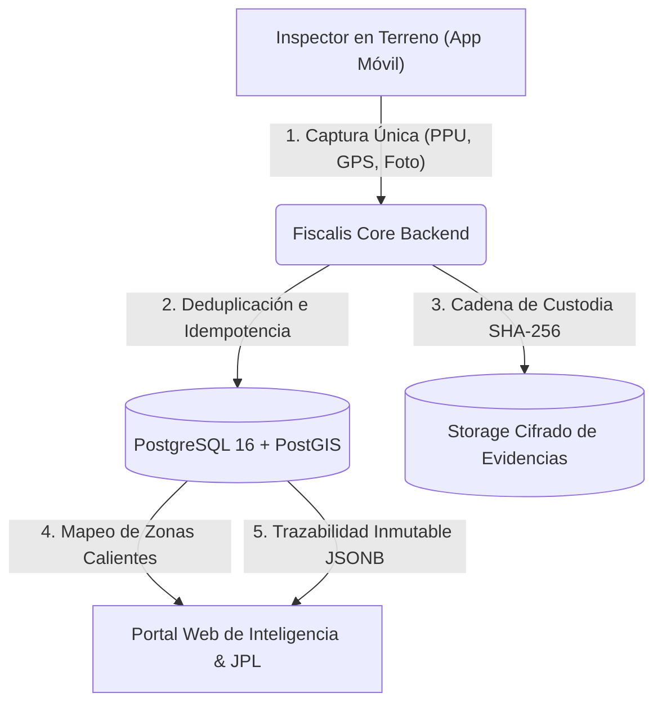
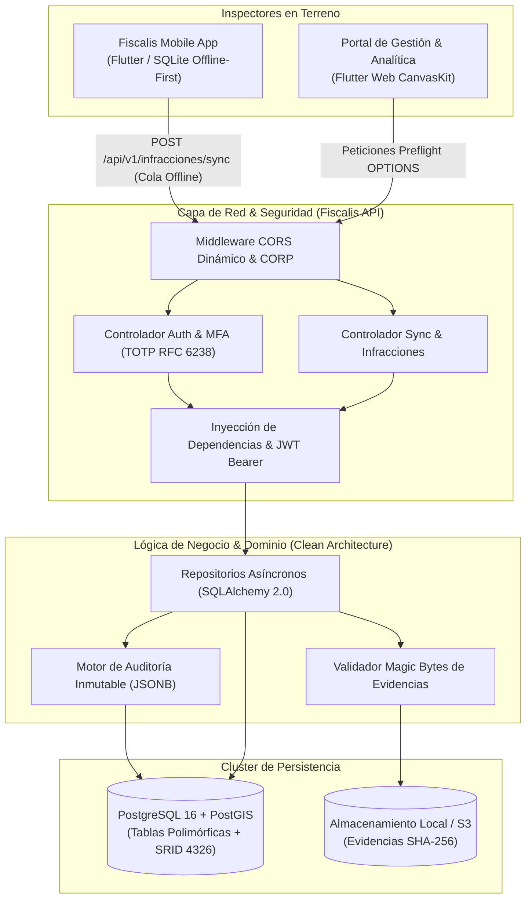

# Fiscalis 🏛️
### Plataforma Integral de Fiscalización Municipal, Geointeligencia y Gestión de Tránsito

[](https://github.com/naxo16/Fiscalis)
[](https://www.python.org/)
[](https://fastapi.tiangolo.com/)
[](https://www.postgresql.org/)
[-D71F00.svg?logo=sqlalchemy&logoColor=white)](https://www.sqlalchemy.org/)
[-brightgreen.svg?logo=pytest&logoColor=white)](https://pytest.org/)
[](https://owasp.org/)
[](#-arquitectura-del-sistema)
[](#-licencia)

---

## 📖 Visión del Proyecto y Problema que Resuelve

En la gestión municipal tradicional, el proceso de fiscalización en vía pública sufría de una **alta carga burocrática, fragmentación y riesgo operacional**:
* **Ineficiencia Operativa (3 funcionarios para 1 misma acta)**: Tradicionalmente, un inspector levantaba el parte en papel en la calle, un segundo funcionario transcribía manualmente el documento en la oficina comunal y un tercero lo clasificaba para el Juzgado de Policía Local (JPL).
* **Duplicidad y Pérdida de Información**: Errores humanos de tipeo, doble digitación de infracciones y actas traspapeladas o ilegibles por lluvia o deterioro físico.
* **Falta de Trazabilidad y Cadena de Custodia**: Imposibilidad de auditar la autenticidad temporal y geográfica de las evidencias fotográficas presentadas ante el juez.
* **Riesgo y Exposición en Terreno**: Tiempos excesivos de permanencia del inspector en la vía pública redactando partes manuales, exponiéndose a situaciones de peligro, hostilidad o agresiones.

### 💡 La Solución Fiscalis
**Fiscalis** transforma este flujo mediante una solución integral (**App Móvil Offline-First + Backend Transaccional Geoespacial**):
1. **Acción Directa en Terreno**: El inspector digitaliza, fotografía y georreferencia el acta en segundos directamente desde el lugar del suceso. Lo que antes requería 3 personas en etapas desconectadas, hoy se realiza en un único flujo automatizado.
2. **Cero Duplicidad de Datos**: Arquitectura con UUIDs universales y repositorio con verificación de **idempotencia**, impidiendo el doble registro o inconsistencias en reintentos de red.
3. **Centralización y Cadena de Custodia Inmutable**: Ingesta en tiempo real con hashes criptográficos SHA-256 de evidencias y pistas de auditoría forense (`auditoria_eventos` en JSONB).
4. **Monitoreo en Vivo y Seguridad del Inspector**: Reducción drástica del tiempo de exposición en la calle y telemetría de última conexión (`last_seen_at`) para resguardo del equipo en terreno.
5. **Geointeligencia y Zonas Calientes (*Heatmaps*)**: Motor PostGIS (`SRID 4326`) que procesa coordenadas exactas para generar analítica de rutas de patrullaje, identificación de focos críticos de infracciones y filtros analíticos avanzados (citaciones graves JPL vs. advertencias empadronadas).

---

## 🎯 Capacidades Principales



* **Operación Offline-First Resiliente**: Si el inspector fiscaliza en zonas rurales o puntos ciegos sin cobertura celular, el acta se almacena localmente y la cola asíncrona la sincroniza en cuanto recupera señal.
* **Seguridad y Ciberseguridad Institucional**:
  * Autenticación en dos pasos obligatoria (**MFA TOTP RFC 6238**).
  * Secretos cifrados en reposo mediante **Fernet (AES-256)** con rotación de llaves.
  * Mitigación activa de **OWASP Top 10** (protección contra timing attacks, sanitización anti-inyección en WKT, headers de seguridad HTTP y paginación acotada).
* **Interoperabilidad Web & Móvil**: Headers `Cross-Origin-Resource-Policy` y CORS dinámico para Flutter Web CanvasKit y aplicaciones móviles nativas.
* **Cumplimiento Legal (Chile)**: Tipificación parametrizada según la Ley N° 18.290 de Tránsito, trazabilidad electrónica bajo Ley N° 21.180 (Transformación Digital) y ciberseguridad según Ley N° 21.663.

---

## 🏗️ Arquitectura del Sistema (Clean Architecture)



---

## 🚀 Tecnologías Clave

| Categoría | Tecnología | Versión | Propósito en Fiscalis |
| :--- | :--- | :--- | :--- |
| **Lenguaje** | Python | 3.12+ | Motor backend asíncrono de alto rendimiento |
| **Framework Web** | FastAPI | 0.111+ | Servidor ASGI moderno, validación Pydantic v2 y OpenAPI automático |
| **Base de Datos Geoespacial** | PostgreSQL + PostGIS | 16 / 3.4+ | Consultas espaciales (`Point` SRID 4326), mapas de calor y JSONB |
| **ORM / Acceso a Datos** | SQLAlchemy + Asyncpg | 2.0+ | Patrón repositorio con sesiones asíncronas no bloqueantes |
| **Control de Esquema** | Alembic | 1.13+ | Migraciones versionadas y reproducibles |
| **Criptografía & MFA** | PyOTP + Fernet + Passlib | - | Autenticación TOTP (RFC 6238), Bcrypt (12 rounds) y AES-256 |
| **Testing & QA** | Pytest + HTTPX + Asyncio | 9.0+ | Suite automatizada de 17 tests (seguridad, integración, CORS, E2E) |
| **Contenerización** | Docker & Docker Compose | Multi-etapa | Despliegue en un comando y orquestación del stack |

---

## 📁 Estructura del Repositorio

```
Fiscalis/
├── app/
│   ├── api/                  # Capa de presentación y red
│   │   ├── endpoints/        # Controladores REST (auth, infracciones, salud)
│   │   └── deps.py           # Inyección de dependencias (DB session, auth activa)
│   ├── core/                 # Configuración central, settings y criptografía
│   │   ├── config.py         # Variables de entorno pydantic-settings
│   │   ├── database.py       # Engine asíncrono y sesión SQLAlchemy
│   │   └── security.py       # Hashing Bcrypt y emisión de JWT
│   ├── models/               # Modelos de dominio y tablas ORM
│   │   ├── base.py           # Base declarativa
│   │   ├── usuarios.py       # Roles (RBAC), inspectores, MFA y terminales
│   │   ├── registros.py      # Herencia polimórfica (RegistroBase, InfraccionVehicular)
│   │   └── auditoria.py      # Pistas de auditoría JSONB y eventos de sincronización
│   ├── repositories/         # Capa de persistencia (Patrón Repositorio)
│   │   ├── auth_repository.py
│   │   ├── sync_repository.py
│   │   └── infracciones.py
│   ├── schemas/              # Modelos DTO Pydantic v2
│   ├── services/             # Servicios de negocio (Magic Bytes, almacenamiento)
│   └── tests/                # Suite de pruebas automatizadas (17 tests asíncronos)
├── alembic/                  # Migraciones versionadas de base de datos
├── scripts/                  # Scripts de inicialización y utilitarios locales
├── Dockerfile                # Empaquetado optimizado para producción
├── docker-compose.yml        # Orquestador del stack completo (PostgreSQL PostGIS + API)
├── requirements.txt          # Dependencias congeladas
└── main.py                   # Entry point ASGI (Uvicorn)
```

---

## ⚡ Instalación y Puesta en Marcha

### Prerrequisitos
* Python 3.12 o superior (o Docker & Docker Compose).
* PostgreSQL 16 con extensión PostGIS instalada.

### Opción A: Despliegue con Docker Compose (Recomendado para Producción)

```bash
# 1. Clonar el repositorio
git clone https://github.com/naxo16/Fiscalis.git
cd Fiscalis

# 2. Configurar variables de entorno
cp .env.example .env

# 3. Construir y levantar el contenedor en segundo plano
docker compose up -d --build
```
La API quedará operativa de inmediato en `http://localhost:8000`.

---

### Opción B: Ejecución en Entorno Local con Virtualenv

```bash
# 1. Crear y activar el entorno virtual
python -m venv venv

# En Windows:
venv\Scripts\activate
# En Linux/macOS:
source venv/bin/activate

# 2. Instalar dependencias
pip install -r requirements.txt

# 3. Configurar variables de entorno
cp .env.example .env

# 4. Aplicar migraciones de base de datos
alembic upgrade head

# 5. Iniciar servidor de desarrollo
uvicorn app.main:app --host 127.0.0.1 --port 8000 --reload
```

---

## 📡 Endpoints Principales de la API

| Método | Endpoint | Descripción | Requiere Auth |
| :---: | :--- | :--- | :---: |
| `GET` | `/health` | Health check institucional (estado de API y PostgreSQL) | No |
| `POST` | `/api/v1/auth/login` | Login inicial; emite JWT o desafío MFA según corresponda | No |
| `POST` | `/api/v1/auth/mfa/verify` | Valida código TOTP (RFC 6238) y emite token final de sesión | No |
| `POST` | `/api/v1/auth/mfa/validate` | Desbloqueo rápido de sesión tras hibernación en terreno | Sí (Bearer) |
| `POST` | `/api/v1/infracciones/sync` | Ingesta atómica de actas vehiculares, coordenadas y evidencias | Sí (Bearer) |
| `GET` | `/api/v1/infracciones` | Consulta de actas con paginación acotada anti-DoS | Sí (Bearer) |
| `GET` | `/docs` | Interfaz interactiva Swagger UI / OpenAPI | No |

---

## 🧪 Pruebas Automatizadas (QA Suite)

La suite de pruebas asíncronas garantiza la estabilidad en terreno, el manejo de errores, la seguridad criptográfica y la resiliencia ante cortes de red.

Para ejecutar los 17 tests asíncronos:
```bash
pytest app/tests -v
```

### Resultados de Cobertura Verificada:
```text
collected 17 items

app/tests/test_auth.py::test_login_con_credenciales_validas_retorna_token_o_challenge PASSED [  5%]
app/tests/test_auth.py::test_mfa_verify_o_login_directo_emite_jwt_final_con_usuario PASSED   [ 11%]
app/tests/test_auth.py::test_login_password_incorrecta_retorna_401 PASSED                    [ 17%]
app/tests/test_auth.py::test_login_usuario_inexistente_retorna_401 PASSED                    [ 23%]
app/tests/test_auth.py::test_mfa_validate_desbloqueo_sesion PASSED                           [ 29%]
app/tests/test_auth.py::test_token_invalido_rechaza_401 PASSED                               [ 35%]
app/tests/test_cors_flutter_web.py::test_cors_preflight_flutter_web_port PASSED              [ 41%]
app/tests/test_cors_flutter_web.py::test_cors_preflight_127_0_0_1_port PASSED                 [ 47%]
app/tests/test_cors_flutter_web.py::test_cors_preflight_arbitrary_flutter_port PASSED         [ 52%]
app/tests/test_cors_flutter_web.py::test_cors_post_request_includes_corp_header PASSED       [ 58%]
app/tests/test_health.py::test_health_check_returns_200 PASSED                               [ 64%]
app/tests/test_infracciones.py::test_sync_sin_token_rechaza_401 PASSED                       [ 70%]
app/tests/test_infracciones.py::test_sync_payload_corrupto_rechaza_422 PASSED                 [ 76%]
app/tests/test_infracciones.py::test_sync_falla_servidor_gatilla_backoff_500 PASSED           [ 82%]
app/tests/test_sync_e2e.py::test_sync_infraccion_vehicular_e2e PASSED                        [ 88%]
app/tests/test_sync_e2e.py::test_sync_idempotencia_no_duplica PASSED                         [ 94%]
app/tests/test_sync_e2e.py::test_listar_infracciones PASSED                                  [100%]

============================= 17 passed in 50.85s =============================
```

---

## 🔒 Seguridad, Gobernanza y Confidencialidad

* **Políticas de Ciberseguridad (Ley N° 21.663)**: Desarrollado bajo principios de *Security by Design* y *Privacy by Default*.
* **Protección de Datos Sensibles**: En estricto cumplimiento de la Ley N° 19.628 de Protección de Datos Personales, los volcados de bases de datos (`.sql`), manuales internos de contingencia/DRP y diccionarios de datos se gestionan de forma restringida en el entorno local institucional y están excluidos del repositorio público vía `.gitignore`.
* **Auditoría Forense Inmutable**: Cada acción sobre un acta genera un registro no volátil en `auditoria_eventos` con timestamp UTC, identificación del inspector y payload íntegro.

---

## 📄 Licencia

Este proyecto está distribuido bajo licencia institucional / MIT. Consulta los lineamientos municipales para más detalles sobre su distribución e interoperabilidad.

---

<p align="center">
  <b>Fiscalis</b> — Transformando la fiscalización comunal con tecnología moderna, robusta y transparente.
</p>